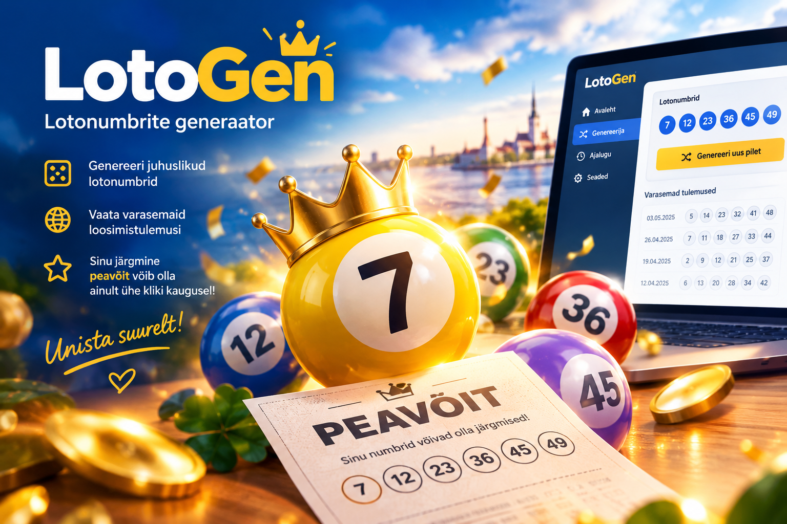

<div>
  <p align="center">
    <font size="1">Pilt on loodud AI abil</font><br />
    
  </p>
</div>

# LotoGen
Rakendus mis genereerib varasemate loosimiste põhjal Bingo, Vikingi ja Eurojackpoti pileti. Kirjutatud Pythonis.

## Sisukord
- [Lühikirjeldus](#lühikirjeldus)
- [Failistruktuur](#failistruktuur)
- [Funktsionaalsus](#funktsionaalsus)
- [Tehnoloogiad](#tehnoloogiad)
- [Beautiful Soup](#beautiful-soup)
- [CustomTkinter](customtkinter)
- [Alfaversioon](#alfa)
- [Beetaversioon](#beeta)
- [Võimalik edasiarendus](#võimalik-edasiarendus)
- [Arendusprotsess](#arendusprotsess)

## Lühikirjeldus

Antud rakendus loeb Eesti Loto lehelt ette antud loodimiste arvu <br>
lotonumbreid (Bingo, Viking ja Eurojackpot) ning genereerib enim <br>
levinud numbrite põhjal uued loosimisnumbrid.

Kasutame oma rakenduses seniõpitut, näieks massiivid, tsüklid, <br>
tingimuslaused jne. Lisaks sellele on rakendusel kaks suuremat osa, <br>
mis on siis jagatud vastavalt kahe projektikaaslase vahel.

Autorid(progejad):
* Elis Maarja Aardevälja
* Martin Maasik

**GUI** - ülimalt äge ja kaasatõmbav kasutajaliides.
Kasutajaliides kuvab numbrid vastavalt loto standardile:
Bingo - 5 x 5 ruudustik
Viking - 6 põhinumbrit ja 1 lisanumber
Eurojackpot - 5 põhinumbrit ja 2 lisanumbrit

**Scraper** - varasemate loosimistulemuste hankimine vastavalt ette antud numbrile
kui mitu loosimist hangitakse.

## Failistruktuur

| Fail | kirjeldus |
|-|-|
| jp_gui.py | Kasutajaliides andmete sisestamiseks/väljastamiseks |
| main.py | Põhiprogramm |
| jp_scraper.py | Eesti Loto lehelt varasemate loosimiste hankimiseks |
| jp_generator.py | Genereerib loto piletite numbrid |
| jp_random.py | Juhusliku pileti genereerimiseks |
| /pic | Kataloog projektis kasutatavate piltide jaoks |

## Funktsionaalsus

| Funktsioon | Kirjeldus | Lisatud |
| - | - | - |
| Lotonumbrite scrapimine Eesti Loto lehelt | Selleks kasutusel Beutyful Soap | ✓ |
| Lotonumbrite talletamine | Kogutud numbrid talletatakse listidesse | ✓ |
| Enimlevinud numbrite põhjal uute lotonumbrite loomine | Listid käiakse tsükliga läbi | ✓ |
| Kasutajaliidese loomine | Kasutusel Tkinter ja Custom Tkinter | ✓ |
| Vikingloto piletite loomine | Alfa versiooni nõue | ✓ |
| Eurojackpoti ja Bingo piletite loomine | Beeta versiooni nõue | ❌ |
| Juhusliku lotokombinatsiooni loomine | Kasutades Math.Random | ✓ |
| Loodud numbrite võrdlemine viimase loosimisega | Õigete numbrite taust muutub roheliseks | ❌ |
| Kõigi lotonumbrite genereerimisel salvestatakse need ka CSV faili | Faili kirjutamise harjutamiseks | ✓ |

## Tehnoloogiad

Rakendus on kirjutatud täielikult Pythonis ning kasutajakeskkonnaks
on töölauarakendus(desktop app). 

Versioonihaldusena kasutusel Git ja github.
Repo: https://github.com/mmeest/jackpot

Scraperi tarvis on valitud Beautiful Soup. GUi teegid/tööriistad projektile hetkel veel kinnitamata.

Scraperi võimalikud tööriistad:
* Beautiful Soup - https://beautiful-soup-4.readthedocs.io/en/latest/
* Scrapy - https://www.scrapy.org/
* Playwright - https://playwright.dev/
* Requests - https://pypi.org/project/requests/

GUI tarvis sai valitud Custom Tkinter

GUI võimalikud tööriistad:
* Custom Tkinter - https://customtkinter.tomschimansky.com/  https://github.com/TomSchimansky/CustomTkinter
* Tkinter - https://docs.python.org/3/library/tkinter.html
* PySide6 - https://pypi.org/project/PySide6/

## Beautiful Soup

Thonnyle tuleb paigaldada tööriistad (Tools > Manage packages):

* beautifulsoup4
* requests

Ning need importida

```
from bs4 import BeutyfulSoup
import requests
import json   # päringu vastuste tarvis
```

Kasutatud materjalid:

* Youtube Beautiful Soup 4 Tutorial #2 - Searching and Filtering https://www.youtube.com/watch?v=lOzyQgv71_4
* Beautiful Soup Documentation: https://beautiful-soup-4.readthedocs.io/en/latest/

## CustomTkinter

Thonnyle tuleb paigaldada tööriist customtkinter (Tools > Manage packages)
Ning seejärel see rakendusse importida

```
import customtkinter as ctk
```

Kasutatud materjalid:

* Tkinter ametlik lehekülg: https://customtkinter.tomschimansky.com/
* Youtube - All Customtkinter Widgets Explained FAST [Modern GUI Python Library] https://www.youtube.com/watch?v=lCmHnrX6ZHU
* Youtube - How to Create a Window in CustomTkinter - Python GUI with CustomTkinter https://www.youtube.com/watch?v=Q7_Ts5fa-Vg
* CustomTkinter - A Complete Tutorial https://dev.to/devasservice/customtkinter-a-complete-tutorial-4527
* Modern Tkinter Design With CustomTkinter - video õpetusseeria Youtubes - https://www.youtube.com/watch?v=Y01r643ckfI&list=PLfZw_tZWahjxJl81b1S-vYQwHs_9ZT77f
* Tkinter Designer - veebipõhine tkinter api kujundamine - https://visualtkinter.com/designer?target=ctk

## Alfa

Alfaversioon (Tähtaeg 11.november 2026)

Alfaversioonis peaks rakendus suutma lugeda ja genereerida Viking loto numbrid 
vastavalt varasematele loosimistele ning kuvama need kasutajaliideses.
Kasutajaliideses on loodud minimaalselt selleks vajalik: nupud, tekstiväljad.

## Beeta

Beetaversioon (Tähtaeg 16. detsember 2026)

Beeta versioon on täiendatud ka Bingo ja Eurojackpot loteriidega.

## Võimalik edasiarendus

* Random loterii piletite genereerija
* Võimalus võrrelda oma piletit viimase loosimisega(kas oleks võitnud?)
* Genereeritud numbrite salvestamine ja lugemine (CSV) faili

## Arendusprotsess

* Projektirühmaks sai valitud 'Hava' ning foorumisse tehtud sissekanne projektikaaslase leidmiseks, kuna projekti tuleb teha kahekesi.
* Projektiga liitus huviline, kes soovis koos arendada
* Tekkis idee arendada rakendus, mis otsib varasemate loteriide tulemused ning genereerib uued piletid eelnevate alusel
* See tundus kahele arendajale sobiv projekt kuna selle saab jagada kaheks suuremaks osaks webscraper ning graafiline kasutajaliides
* Projektikaaslasel endal ei olnud arendusideed ning talle sobis välja pakutud projekt hästi
* Projektist sai koostatud kirjeldus ning see ära esitatud
* Projektile sai versioonihalduse jaoks loodud ka Github repo ning see jagatud projektikaaslasega
* Arendusprotsess hakkas pihta, kuid projektikaaslasega enam ühendust ei saanud
* Ühel päeval märkasin, et projektikaaslane on mu projektist tevitamata lahkunud, tegin Zulipisse ja foorumisse uue üleskutse kaaslase leidmiseks ning jätkasin samal ajal üksi arendust
* Esimese osana sai pihta hakatud scraperist, mille tarvis kasutasin tööriista Beautyful Soup, mis on ideaalne veebist lugemiseks
* Algselt sai loogika üles ehitatud nii, et hankida iga loto viimane ja sellest tulenevalt vastavalt soovitud loosimiste arvule loosinumber > loosimise ID > lotonumbrid
* Lõplik lahendus hangib viimase loosi põhjal etteantud koguse varasemaid tulemusi, kuna selleks ei ole vaja iga loosimise poole eraldi pöörduda
* Rakendus sai vastavalt funktsionaalsusele jagatud osadeks: projekti põhimeetod ehk main, scraper, numbrite generaator, random generaator, tulemuste kontrollija ning kasutajaliides
* Alfaversioon peaks suutma etteantud juhistele genereerima varasemate loosimiste põhjal Viking loto numbrid
* Beetaversioon peaks suutma teha seda ka Eurojackpoti ning Bingo puhul. Lisaks võimalikud funktsionaalsused nagu juhusliku kombinatsiooni genereerimine ja tulemuste võrdlemine viimase loteriiga
* Numbrite scrapemisele Eesti Loto lehelt järgnes nende robustne talletamine vastavalt valikule etteantud 5 listi(Viking põhinumbrid, Viking lisanumbrid, Eurojackpot põhinumbrid, Eurojackpot lisanumbrid, Bingo numbrid). Bingo numbrid talletatakse omakorda kahemõõtmelisse listi, millest sisemised on vastavalt B, I, N, G, O
* Sellele järgneb tsükli abil listist enim levinud numbrite leidmine, et neist koostada uued lotonumbrid
* Kui pileti genereerimise osa oli valmis, sai valitud kasutajaliidese jaoks Tkinter ja CustomTkinter
* Võrreldes XML ja HTML kujundusele on Tkinter algselt küll pisut ebamugav, kuid nende kodulehe ja youtube juhendite abil sai põhiline peagi selgeks
* Kuna aga selline arendamine ei ole just kõige mugavam, sai algne kujundus siiski loodud https://visualtkinter.com/customtkinter tasuta keskkonnas
* Antud Readme faili päisesse lisatud pilt sai loodud AI abil ning oma rakenduse välimuse kujundamisel hankisin inspiratsiooni sellel pildil olevalt kujunduselt. Samuti rakenduses kasutatud logo on välja lõigatud sellelt pildilt
* Kui kasutajaliides oli ses suhtes valmis, et kõik soovitud elemendid paigas, tuli välja, et tekstiväljad on liiga väikesed ja kahekohalised numbrid ei mahu neile korralikult ära
* Katse-eksitus meetodi asemel elementide mõõtmete muutmise asemel valisin lahenduseks mõõtmete korrutajate lisamise lahenduse, kus väga lihtsalt saab rakenduse akna kõigi elementide mõõte muuta. Sarnast lahendust sai kunagi ühe teise keskkonna suhtes kasutatud, et mugavalt elementide mõõte muuta
* Kui UI oli valmis, siis hakkas kõige põnevam osa, ehk rakenduse kasutajaliidese ja taustakoodi ühendamine
* Projekti lisati Elis Maarja Aardevlja
* Pärast koodiga tutvumist tehti kiired parandused (kirjavead, errorite vältimine)
* Lisati juurde võimalus näha varasemate piletite statistikat vastavalt kasutaja sisendile ehk programm kuvab, kui mitu korda 10 kõige tihedamini ilmunud numbrit kasutaja antud kordadele vastavalt on loositud
* Lisati kood, et genereeritud tulemused lisataks CSV faili (vajadusel luuakse fail), kus on välja toodud täpne kellaaeg ja kuupäev, pileti liik ja loositud numbrid tabelina
* Piirati loosimiste arv, et programm liiga mahukaks ei läheks
* Aktiveeriti järgmine nupp, mis genereerib Vikingu piletile suvalised arvud
